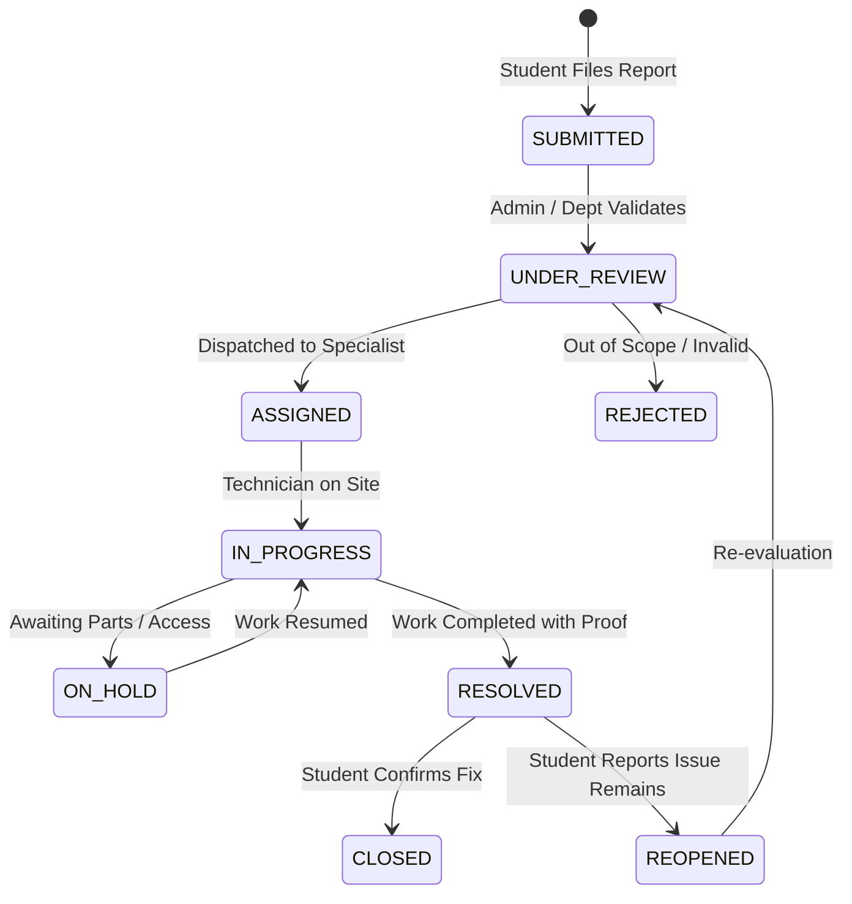

# CampusCare: Campus Problem Reporting and Management System

[](https://github.com/anilanji22515-alt/Ramayan/actions)


**CampusCare** is a centralized, transparent web application engineered for college campuses. It empowers students to report campus infrastructure and service problems with evidence, structured locations, and priority classifications. The platform automatically dispatches reports to responsible maintenance departments, provides transparent status lifecycles, guarantees student privacy, and dispatches automated parent notifications.

---

## 🚀 Key System Features & Specification Compliance

### 1. Automatic Department Routing (16 Problem Categories)
Complaints are automatically routed to the responsible department queue upon submission:
1. **Classrooms** &rarr; Facilities & Civil Maintenance (`D001`)
2. **Water and Sanitation** &rarr; Plumbing and Water (`D004`)
3. **Electricity and Lighting** &rarr; Electrical Maintenance (`D002`)
4. **Wi-Fi and Internet** &rarr; IT and Network Support (`D003`)
5. **Furniture** &rarr; Facilities & Civil Maintenance (`D001`)
6. **Washrooms** &rarr; Sanitation & Housekeeping (`D005`)
7. **Roads and Infrastructure** &rarr; Facilities & Civil Maintenance (`D001`)
8. **Mess/Food** &rarr; Mess & Food Services (`D006`)
9. **Health and Medical Facilities** &rarr; Medical & Health Services (`D008`)
10. **Security** &rarr; Campus Security (`D007`)
11. **Laboratories and Equipment** &rarr; IT & Network Support (`D003`)
12. **Library** &rarr; Library Services (`D009`)
13. **Hostel and Accommodation** &rarr; Hostel Administration (`D010`)
14. **Sports and Recreation** &rarr; Sports & Recreation (`D012`)
15. **Transport and Parking** &rarr; Transport & Parking (`D011`)
16. **Other** &rarr; Central Campus Administration (`D001`)

### 2. Mandatory Parent/Guardian Email Notification
* **Configured Central Recipient**: `anilanji22515@gmail.com` (configured securely on backend via `PARENT_NOTIFICATION_EMAIL` or directly in the Admin Email Configuration GUI).
* **Live vs. Simulated Dispatch**:
  * **Live Delivery**: Turn on "Enable Live SMTP Dispatch" in the Admin Dashboard, enter your SMTP user and app password (e.g. Gmail 16-character App Password), and all complaint submissions immediately dispatch real emails across the internet to `anilanji22515@gmail.com`.
  * **Simulation Mode**: If SMTP credentials are not yet configured, submissions are safely recorded in the `email_outbox` audit table with status `SIMULATED` and an audit note.
* **Diagnostic Audit Console**: Administrators can inspect outbox delivery statuses (`SENT`, `SIMULATED`, `FAILED`), trigger retries, or dispatch test diagnostic messages directly from the admin dashboard.
* **Privacy-Preserving**: Dispatches complaint reference code, category, location, priority, and submission summary without leaking authentication tokens, passwords, or confidential medical details.

### 3. Role-Based Access Control (RBAC) & Multi-Role Dashboards
* **👨‍🎓 Student**:
  * Submit complaints with title, category, campus location (Building, Block, Floor, Room, Landmark), priority (Low, Medium, High, Emergency), optional photo/video evidence.
  * Real-time duplicate warning indicator when similar issues are detected.
  * Anonymous reporting toggle (identity hidden from department technicians).
  * Interactive status timeline tracking.
  * Post-resolution 5-star rating, problem fixed confirmation, or reopening request.
* **🔧 Department Staff**:
  * View assigned tickets and queue filtered by department.
  * Update workflow status with public updates and private internal staff notes.
  * Upload resolution summary and proof of completion.
* **👔 Department Head**:
  * Assign tickets to specific department staff technicians.
  * Monitor overdue tickets against configured SLA deadlines.
* **🛡️ Campus Administrator**:
  * Executive dashboard with KPI counters (Total, Open, In Progress, Resolved, Overdue, Emergency).
  * Interactive Chart.js analytics (Category distribution, status distribution, department workloads).
  * Override department routing, manage duplicate complaint links, and export data to CSV.

### 4. Lifecycle Status Workflow & SLA Target Tracking


* **EMERGENCY**: 5 min acknowledge, 4 hours target resolution (24/7 priority alert banner + emergency phone guidelines).
* **HIGH**: 2 working hours acknowledge, 24 hours target resolution.
* **MEDIUM**: 1 working day acknowledge, 3 working days target resolution.
* **LOW**: 2 working days acknowledge, 7 working days target resolution.

---

## 🔑 Pre-Configured Demo Accounts

Use the **Instant Role Switcher** in the top navigation bar, or sign in manually with password `demo1234`:

| Role | Name | Email / Identifier | Password | Department Scope |
| :--- | :--- | :--- | :--- | :--- |
| **Student** | Rahul Kumar | `DEMO-CSE-001` or `rahul.demo@example.com` | `demo1234` | Computer Science (Year 2) |
| **Department Staff** | Priya Sharma | `staff.demo@example.com` | `demo1234` | Plumbing and Water (`D004`) |
| **Department Head** | Arun Head | `head.demo@example.com` | `demo1234` | Plumbing and Water (`D004`) |
| **Administrator** | Campus Admin | `admin.demo@example.com` | `demo1234` | Central Campus Administration |

---

## 🛠️ Quick Start Guide

### Prerequisites
* Python 3.10+ installed
* Git

### 1. Clone & Setup
```bash
git clone https://github.com/anilanji22515-alt/Ramayan.git
cd Ramayan
```

### 2. Install Dependencies
```bash
pip install -r requirements.txt
```

### 3. Run the Application
```bash
python app.py
```
Open your browser at **`http://localhost:5000`** to access the interactive web prototype. The SQLite database (`campuscare.db`) is automatically seeded with sample departments, categories, locations, users, and complaints on first launch.

### 4. Run the Acceptance Test Suite
```bash
python test_app.py
```

---

## 🐳 Docker Deployment

Run with Docker Compose:
```bash
docker-compose up --build
```
Or build and run the Docker image directly:
```bash
docker build -t campuscare .
docker run -p 5000:5000 campuscare
```

---

## 🌐 Cloud Deployment (Render / Railway / Heroku)

This repository includes native deployment manifests:
* **Render**: Pre-configured `render.yaml` for 1-click Python web service deployment.
* **Railway / Heroku**: Pre-configured `Procfile` (`web: python app.py`).
* **Environment Variables**:
  * `PARENT_NOTIFICATION_EMAIL`: `anilanji22515@gmail.com`
  * `SECRET_KEY`: `<your-production-secret>`
  * `EMAIL_ENABLED`: `false` (for simulation) or `true` (when configuring SMTP credentials)
  * `SMTP_HOST`: `smtp.gmail.com`
  * `SMTP_PORT`: `587`
  * `SMTP_USER`: `<your-smtp-email>`
  * `SMTP_PASSWORD`: `<your-app-password>`

---

## 📁 Repository Structure

```text
├── .github/workflows/
│   └── ci.yml               # GitHub Actions CI workflow
├── services/
│   └── email_service.py     # SMTP dispatcher & simulated outbox engine
├── static/
│   ├── css/
│   │   └── custom.css       # Badges, transitions, and timeline styles
│   └── js/
│       └── app.js           # Client-side SPA controller & Chart.js logic
├── templates/
│   └── index.html           # Full responsive UI with Tailwind & FontAwesome
├── uploads/
│   └── .gitkeep             # Secure private attachment storage
├── app.py                   # Flask REST API endpoints & route handlers
├── config.py                # App configuration & environment settings
├── database.py              # SQLite schema definition & initial seed generator
├── Dockerfile               # Production container definition
├── docker-compose.yml       # Docker Compose service definition
├── Procfile                 # Process manifest for cloud PaaS
├── render.yaml              # Render blueprint deployment file
├── requirements.txt         # Python package dependencies
├── test_app.py              # Automated test suite (all 5 core test cases)
├── .env.example             # Sample environment configuration template
├── .gitignore               # Ignored files (DB, caches, secrets, uploads)
└── README.md                # Comprehensive documentation
```

---

## 🔒 Security & Privacy Engineering
* **Password Hashing**: Passwords are securely digested using standard SHA-256 hashes.
* **Internal Note Protection**: Staff technical notes are completely stripped from student API responses (`internal_note = None`).
* **Anonymous Anonymization**: When a student checks anonymous reporting, their name and college roll ID are concealed as `Anonymous Student` for department personnel.
* **Anti-Double-Click Guard**: Submission triggers client-side button lock and backend verification to eliminate duplicate submissions.

---

## 📄 License
This project is prepared for college prototype demonstration and academic evaluation.
